# Tidepool

A macOS menu-bar app that puts a live, interactive web page behind your desktop icons. It comes
with a set of ASCII-art animal wallpapers that react to the cursor and to clicks on the desktop.

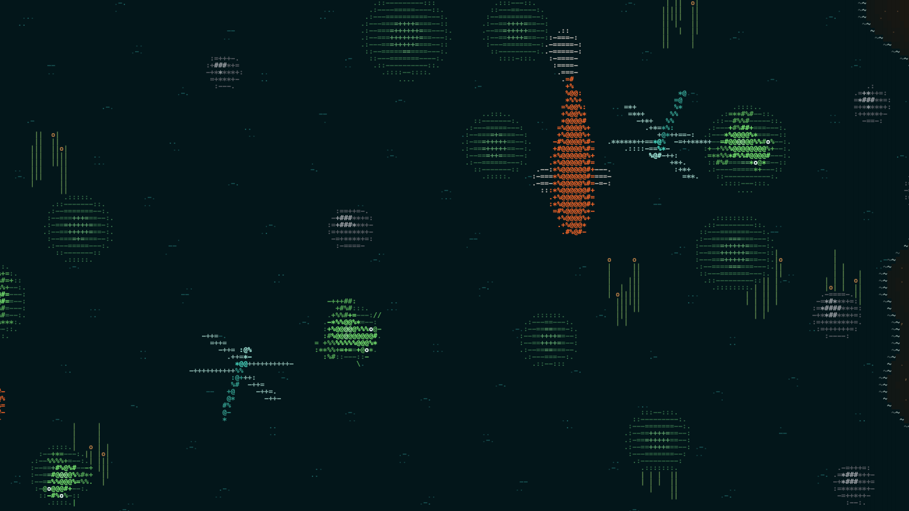

Requires macOS 14 or later and the Swift toolchain (Xcode or the command line tools).

    ./scripts/build.sh --run     # builds build/Tidepool.app and (re)launches it

The fish icon in the menu bar picks the wallpaper, opens its settings, pauses it, and quits.

## ASCII Ecosystem

All the animals in one world. The view drifts slowly from open sea past a koi pond, lily-pad
shallows, a beach and a meadow to a lake, then back again.

| | |
|:-:|:-:|
| 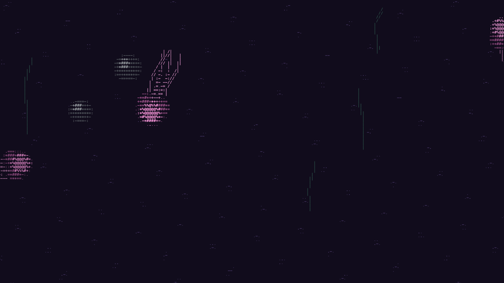 Open sea | 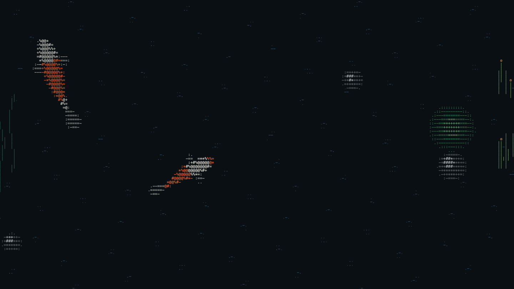 Koi pond |
|  Shallows | 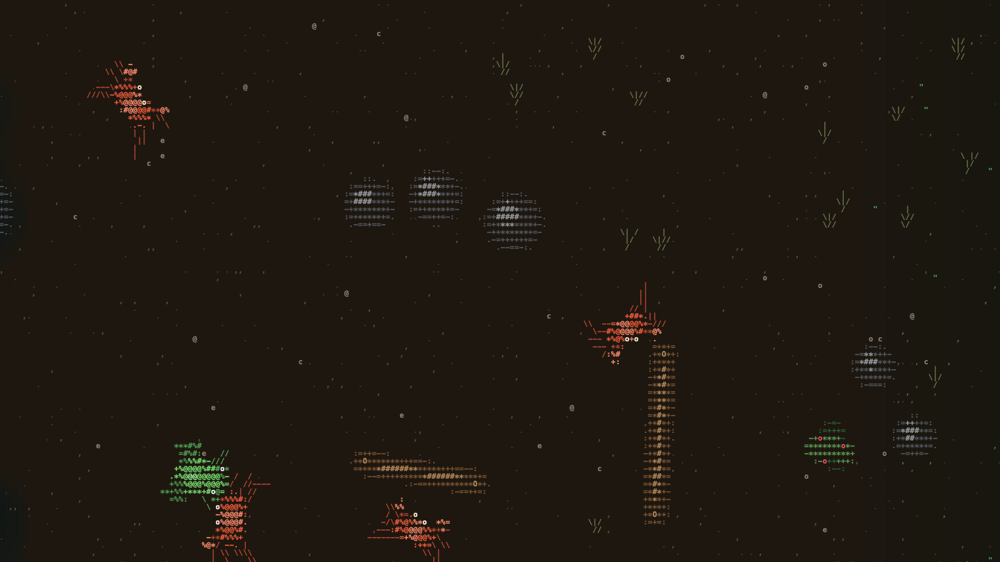 Beach |
| 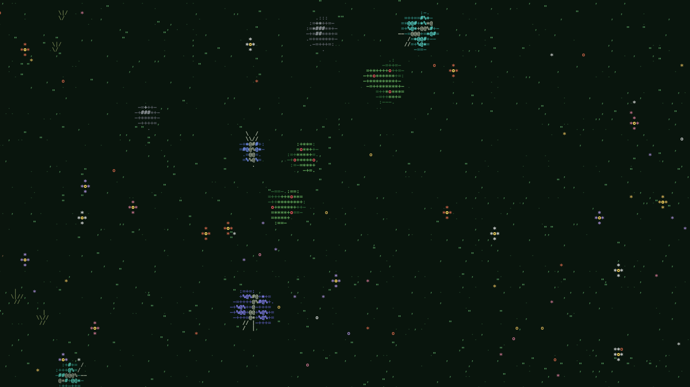 Meadow | 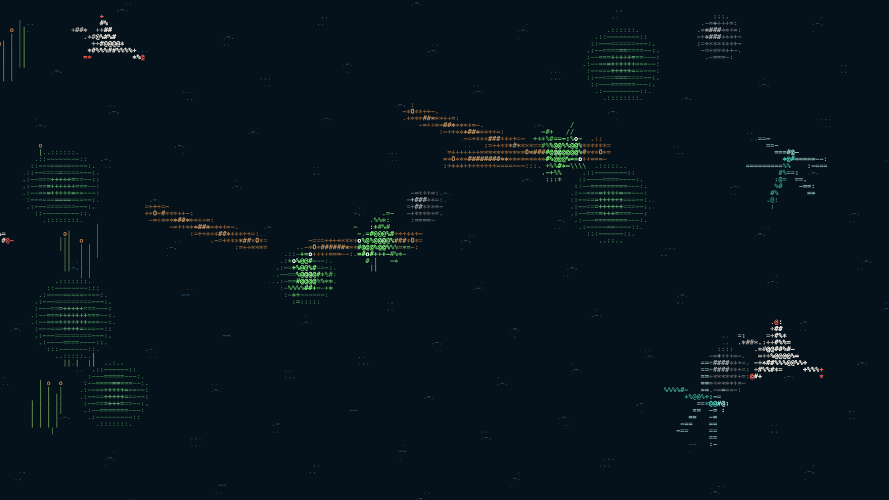 Lake |

## The wallpapers

Each animal is also a wallpaper of its own, with settings for how many there are, how they
move, their colour, the background, and whether they follow, flee from or ignore the cursor.

| | |
|:-:|:-:|
| 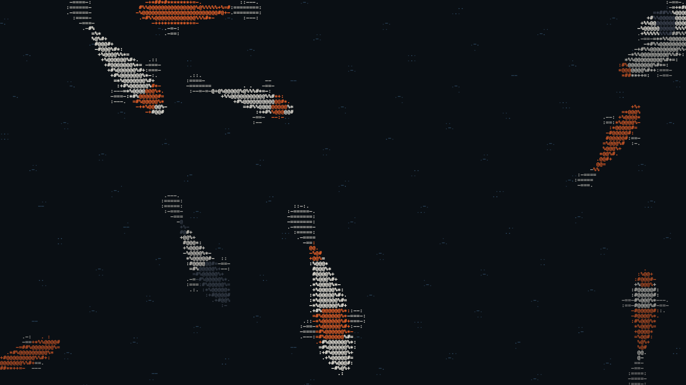 **ASCII Pond**: koi; click to drop food | 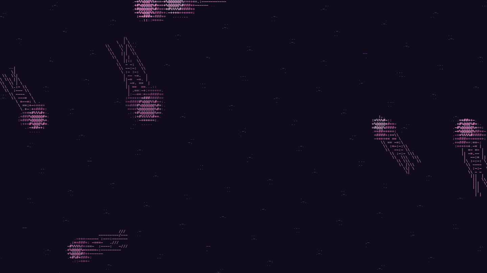 **ASCII Jellyfish**: click to make them jet away |
| 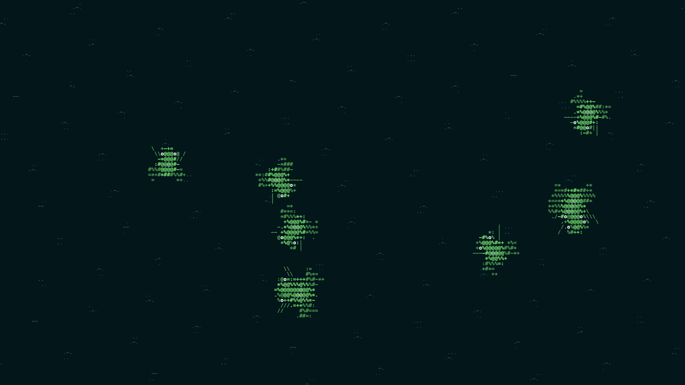 **ASCII Frogs**: they sit, then leap | 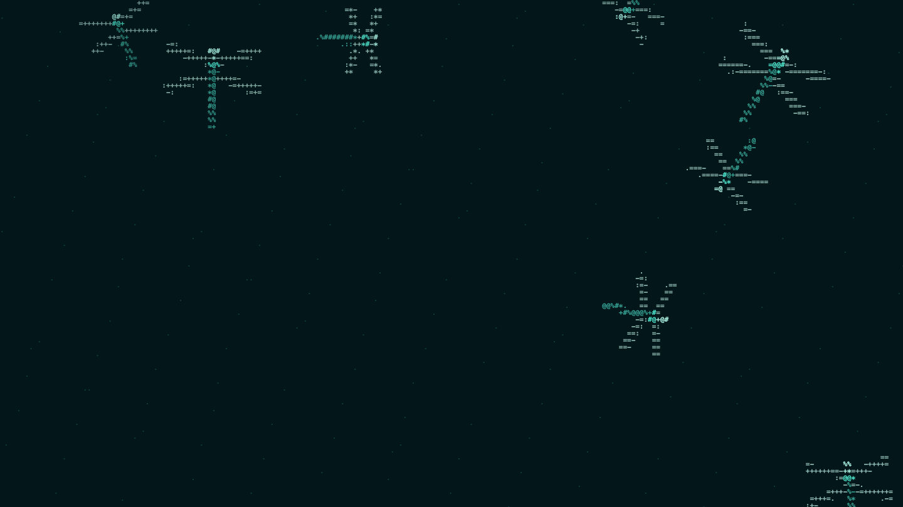 **ASCII Dragonflies**: they hover, then dart |
| 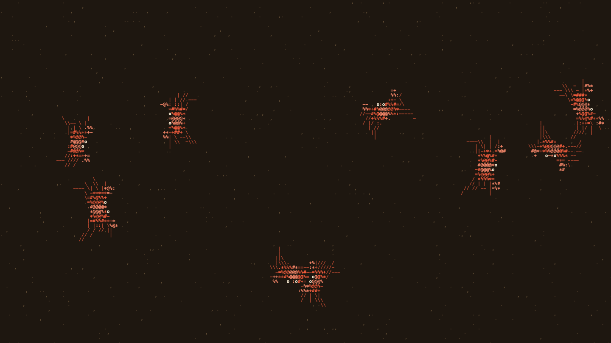 **ASCII Crabs**: click to make them bolt | 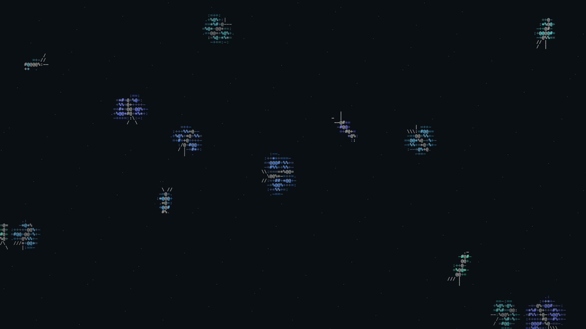 **ASCII Butterflies**: click to scatter them |
| 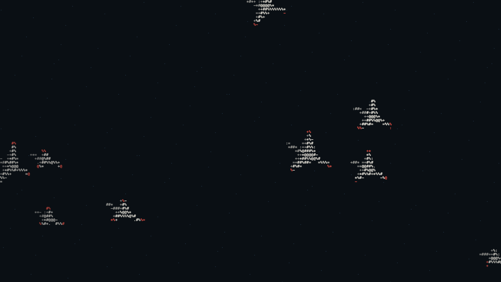 **ASCII Cranes**: a flock of paper cranes | 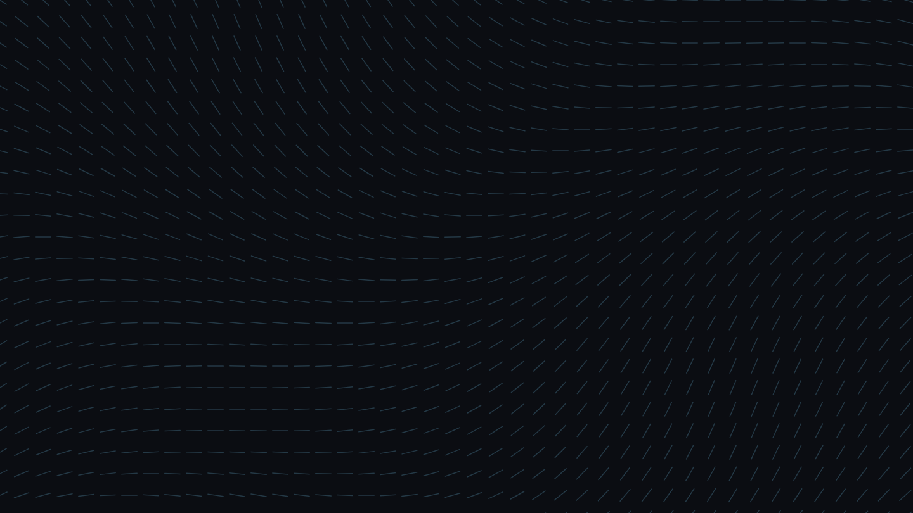 **Compass Field**: needles that turn toward the cursor |

The pictures are stills; the wallpapers are animated. Any of them can be previewed in a browser
by opening its `index.html` from `Wallpapers/`, with settings in the address bar, for example
`index.html?count=20&theme=dusk`.

## How it works

- Each screen gets a borderless window at desktop level (above the system wallpaper, below
  Finder's icons) holding a `WKWebView`.
- That window never receives input, so the app polls the cursor position and watches for
  left-clicks globally, and forwards a click only when no app window covers that spot.
- Drawing stops while the wallpaper is paused or completely covered by other windows.

## Making a wallpaper

A wallpaper is a folder containing `manifest.json` and an HTML page. Put it in
`~/Library/Application Support/Tidepool/Wallpapers/` (menu: Open Wallpapers Folder), then
choose Reload Wallpapers. `Wallpapers/` in this repo holds the built-in ones to copy from.

`manifest.json`:

    {
      "name": "My Wallpaper",
      "description": "Shown in the dashboard.",
      "entry": "index.html",
      "settings": [
        { "key": "speed",  "label": "Speed",  "type": "range",  "min": 0, "max": 2, "step": 0.1, "default": 1 },
        { "key": "glow",   "label": "Glow",   "type": "toggle", "default": true },
        { "key": "colour", "label": "Colour", "type": "color",  "default": "#ff6a2b" },
        { "key": "mode",   "label": "Mode",   "type": "select", "default": "a",
          "options": [{ "value": "a", "label": "First" }, { "value": "b", "label": "Second" }] }
      ]
    }

The dashboard's settings panel is generated from that list. The page gets a `window.wallpaper` object:

    wallpaper.settings                  // current values, keyed by "key"
    wallpaper.pointer                   // { x, y, inside } in page pixels
    wallpaper.paused
    wallpaper.on('settings', (all) => {})     // a value changed; receives every value
    wallpaper.on('pointermove', ({ x, y }) => {})
    wallpaper.on('pointerleave', () => {})    // cursor moved to another screen
    wallpaper.on('click', ({ x, y }) => {})   // a click on the bare desktop
    wallpaper.on('pause', () => {})
    wallpaper.on('resume', () => {})

Pages load from `file://`, so use plain `<script src>` tags rather than ES modules, and stop
your animation loop on `pause`. Right-click is unavailable behind the desktop, but the page
can be inspected from Safari's Develop menu.

## The ASCII wallpapers

The `ascii-*` wallpapers share `Wallpapers/_shared/ascii-engine.js`, which owns the character
grid, the backdrop, ripples, the frame loop and the settings every one of them has (character
size, background, frame rate). Each creature is one small script that says how its animals
move and stamps their shapes into the grid; the comment at the top of the engine lists what a
script provides. To add a creature, copy one of those folders and change its script and
`manifest.json`.

Script errors in any wallpaper are written to the app's log (Console.app, or the terminal if
you run `build/Tidepool.app/Contents/MacOS/Tidepool` directly).
